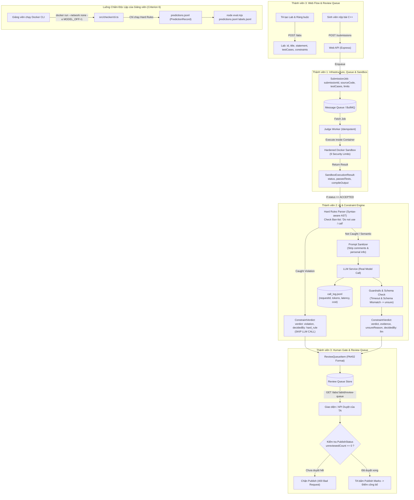

# KẾ HOẠCH PHÂN CHIA NHIỆM VỤ VÀ QUY CHUẨN LÀM VIỆC NHÓM — PA#3 (LEETKOB)

> **Môn học:** CSC13114 — Phát triển ứng dụng Web nâng cao  
> **Cột mốc:** PA#3 — Nguyên mẫu với tính năng LLM hoạt động (Prototype with the LLM feature running)  
> **Hạn chót nộp bài:** 22:00, Thứ Tư, 25/11/2026  
> **Repository:** [https://github.com/USThienPhu/LeeTKOB---WebNC](https://github.com/USThienPhu/LeeTKOB---WebNC) (Tag: `pa3`)  
> **Nhóm thực hiện (3 thành viên):**  
> - 23120319 — Trương Thành Phát  
> - 23120327 — Thái Thiên Phú  
> - 23120380 — Huỳnh Lê Minh Triết  

---

## 1. SƠ ĐỒ LUỒNG DỮ LIỆU LIÊN MODULE (DATA FLOW DIAGRAM)

Sơ đồ dưới đây minh họa sự phối hợp nhịp nhàng giữa 3 phân hệ do 3 thành viên đảm nhận, dựa trên **Bộ Hợp đồng giao tiếp (Interface Contract)** chuẩn đã định nghĩa tại `src/types/`:



---

## 2. BẢNG PHÂN CÔNG CHI TIẾT CHO 3 THÀNH VIÊN

### THÀNH VIÊN 1: Chuyên trách Hạ tầng, Queue & An toàn Sandbox (Infrastructure & Security)
* **Trọng tâm Rubric:** **Tiêu chí 2 (20 điểm)** + một phần **Tiêu chí 7 (TDD & Commit tách biệt)**.
* **Mục tiêu kỹ thuật:** Đảm bảo hệ thống biên dịch và chạy code của người lạ an toàn 100%, không rò rỉ secret, không chạm socket máy chủ; hàng đợi tách biệt với Web server.

#### Các đầu việc cụ thể:
1. **Viết 9 bài kiểm thử tấn công (Attack Submissions) bằng C++:**
   - Đặt tại thư mục `tests/sandbox_attacks/` tương ứng với 9 tiêu chuẩn an toàn trong brief:
     - `01-no-network.cpp`: Kết nối socket ra ngoài internet $\to$ Phải bị chặn hoàn toàn.
     - `02-cpu-limit.cpp`: `while(true)` tiêu tốn CPU $\to$ Bị kill bởi CPU time limit.
     - `03-wall-time-limit.cpp`: `sleep(100)` không tốn CPU $\to$ Container bị kill cưỡng bức bởi wall-clock timeout.
     - `04-memory-limit.cpp`: Cấp phát RAM vượt ngưỡng (1.5GB) và **bắt buộc đọc/ghi lại bộ nhớ** (`for(int i=0; i<N; i+=4096) p[i]=1;`) để compiler không tối ưu hóa bỏ qua $\to$ Bị kill vì OOM.
     - `05-process-limit.cpp`: Fork bomb (`while(1) fork();`) $\to$ Bị chặn bởi `pids-limit`.
     - `06-output-limit.cpp`: Ghi hàng trăm MB rác vào stdout $\to$ Bị ngắt bởi `outputLimitKb`.
     - `07-non-root.cpp`: Thử đọc file hệ thống `/etc/shadow` hoặc ghi vào `/root` $\to$ Quyền bị từ chối (chạy dưới `uid 1000:1000`).
     - `08-no-docker-socket.cpp`: Thử mở `/var/run/docker.sock` hoặc truy cập file của máy chủ host $\to$ File not found.
     - `09-no-secrets.cpp`: Quét `getenv("MODEL_API_KEY")` hoặc đọc file môi trường $\to$ Tuyệt đối không tìm thấy key.
2. **Xây dựng Docker Sandbox Runner (`src/sandbox/runner.ts`):**
   - Viết `Dockerfile.sandbox` nhẹ, cài đặt `g++` và tạo non-root user.
   - Cấu hình lệnh thực thi với đầy đủ các flag bảo mật:  
     `--network none --cpus "1.0" --memory "256m" --memory-swap "256m" --pids-limit 64 --user 1000:1000 --read-only --tmpfs /tmp:rw,noexec,nosuid,size=64m`.
   - Biên dịch và thực thi code bên trong container; trả về `SandboxExecutionResult`.
3. **Triển khai Hàng đợi & Worker Idempotent (`src/queue/`):**
   - Tách rời hoàn toàn Web API khỏi việc chấm bài (dùng BullMQ + Redis hoặc Queue Worker chuyên biệt).
   - Viết test `tests/queue/idempotency.test.ts`: Tắt worker $\to$ sinh viên submit bài $\to$ trạng thái `queued` $\to$ bật lại worker $\to$ bài được chấm đúng 1 lần (lưu đúng 1 tập kết quả).
4. **Cấu hình CI Workflow cho Sandbox:**
   - Cập nhật `.github/workflows/ci.yml` chạy tự động bộ 9 attack tests trong môi trường Docker của GitHub Runner mỗi khi push lên nhánh `feature/sandbox-queue` và tag `pa3`.

---

### THÀNH VIÊN 2: Chuyên trách Phân tích Ràng buộc, LLM & Công cụ Chấm (AI & Constraint Engine)
* **Trọng tâm Rubric:** **Tiêu chí 3 (15 điểm)** + **Tiêu chí 4 (20 điểm)** + **Tiêu chí 5 (Guardrails)** + **Tiêu chí 6 (10 điểm)**.
* **Mục tiêu kỹ thuật:** Rà soát vi phạm cú pháp chính xác tuyệt đối không dính bẫy (đạt 0 wrongful deductions khi tắt model); gọi LLM ngữ nghĩa có bảo vệ dữ liệu và fallback an toàn; đóng gói công cụ CLI chấm dev set cho giảng viên.

#### Các đầu việc cụ thể:
1. **Xây dựng Hard Rules Parser Cú pháp (`src/checker/hard-rules.ts`):**
   - Phát hiện các ràng buộc dạng ban-list (`"Do not use `xyz`"` hoặc `"Do not call `xyz`"`).
   - Dùng Lexer/Tokenizer bóc tách mã nguồn C++, **loại bỏ hoàn toàn string literals và comments trước khi phân tích token**.
   - Vượt qua 4 bẫy (Traps) từ đề bài:
     - Tên hàm cấm nằm trong comment hoặc chuỗi in $\to$ Bỏ qua.
     - Hàm trùng tên nằm trong namespace riêng `my_space::sort()` $\to$ Bỏ qua.
     - `#include <algorithm>` chỉ dùng `std::swap` $\to$ Không phạt.
   - Cơ chế ngắt thông minh: Khi Hard Rule bắt được vi phạm $\to$ Gán `verdict: 'violation'`, lưu dòng bằng chứng `evidence`, và **đánh dấu KHÔNG gọi LLM**.
2. **Xây dựng LLM Client & Prompt Sanitizer (`src/checker/`):**
   - `prompt-sanitizer.ts`: Xóa sạch comment và thông tin nhận dạng sinh viên (tên, MSSV) trước khi gửi vào prompt.
   - `llm-client.ts`: Tích hợp Gemini API (hoặc OpenAI) với API key lưu tại máy chủ. Trả về đúng schema: `verdict` (`pass` | `violation` | `unsure`) và `evidence` (`[{line, text}]`). **Tuyệt đối không để LLM quyết định số điểm trừ (`deduction`)**.
3. **Cài đặt Guardrails & Fallback An toàn (`src/checker/guardrails.ts`):**
   - Schema Guard: Nếu JSON parse lỗi hoặc thiếu trường $\to$ fallback sang `unsure` (`schema_mismatch`).
   - Evidence Guard: Quét file nộp gốc, nếu dòng code trong bằng chứng không khớp ký tự $\to$ fallback sang `unsure` (`evidence_mismatch`).
   - Timeout Guard: Bọc Promise timeout (10-15s) $\to$ quá giờ fallback sang `unsure` (`timeout`).
   - Viết Unit Test Mock Offline (`tests/guardrails/limits.test.ts`): Chứng minh 2 giới hạn trên tự động chuyển thành `unsure` mà không cần kết nối mạng.
4. **Call Logger & Báo cáo Chi phí (`src/checker/call-logger.ts`):**
   - Ghi lại log từng lượt gọi vào `call_log.jsonl`: `requestId` từ provider, `model`, `promptTokens`, `completionTokens`, `latencyMs`, `costUsd`.
   - Tính toán chi phí cho 1 lab 80 sinh viên (đưa vào `README.md` và `AI-LOG.md`).
5. **Xây dựng Checker CLI & `Dockerfile.checker` (Tiêu chí 6):**
   - Script CLI `src/checker/cli.ts` nhận `--dataset <dir>` và `--out <predictions.jsonl>`.
   - Hỗ trợ biến môi trường `MODEL_OFF=1`: Khi bật, chỉ chạy hard rules, semantic rules tự động gán `unsure`, **hoàn toàn không mở kết nối mạng**.
   - Tạo `Dockerfile.checker` độc lập. Đảm bảo chạy với lệnh giảng viên cung cấp, kết quả chạy qua `eval.mjs` có exit code 0 hoặc 1 (không bao giờ lỗi 2).
   - Bổ sung tối thiểu 5 ca kiểm thử tự viết vào thư mục `custom-cases/` (có cả trap và injection).

---

### THÀNH VIÊN 3: Chuyên trách Luồng Web, TA Review Queue & Triển khai Đám mây (Web Flow, TA Review Queue & Deployment)
* **Trọng tâm Rubric:** **Tiêu chí 1 (15 điểm)** + **Tiêu chí 5 (Review Queue)** + **Tiêu chí 8 (5 điểm)** + **Hồ sơ nộp bài PA#3**.
* **Mục tiêu kỹ thuật:** Kết nối toàn bộ pipeline từ lúc TA tạo đề đến lúc duyệt điểm; bảo vệ chốt chặn Human Gate; đưa hệ thống lên Internet công khai và chuẩn bị đầy đủ hồ sơ nộp bài.

#### Các đầu việc cụ thể:
1. **Xây dựng API Quản lý Lab & Sinh viên Nộp bài (`src/routes/`):**
   - `POST /api/v1/classes/:classId/labs`: TA tạo bài lab, cấu hình statement, test cases, và constraints kèm số điểm trừ (`deduction`).
   - `POST /api/v1/classes/:classId/labs/:labId/submissions`: Sinh viên nộp mã nguồn C++, đẩy job vào Queue, nhận mã `submissionId`.
   - `GET /api/v1/submissions/:submissionId`: Sinh viên theo dõi trạng thái biên dịch và pass/fail test cases (không thấy phán quyết vi phạm trước khi công bố).
2. **Tích hợp Pipeline vào Review Queue Endpoint (Kế thừa PA#02):**
   - Nối kết quả từ Engine của Thành viên 2 vào endpoint `GET /api/v1/classes/:classId/labs/:labId/review-queue` đã xây dựng ở PA#02.
   - Hiển thị đầy đủ: `verdict`, dòng bằng chứng `evidence`, và số điểm trừ `suggestedDeduction` do TA thiết lập.
3. **Cài đặt Chốt chặn Human Gate & Thao tác Publish Marks:**
   - Xây dựng endpoint/logic kiểm tra `PublishStatus`:
     - Nếu còn bất kỳ submission nào chưa duyệt $\to$ Khóa nút Publish, trả về `400 Bad Request` nếu cố tình gọi.
     - Khi TA duyệt xong tất cả $\to$ Cho phép Publish, cập nhật điểm chính thức cho sinh viên.
4. **Bảo đảm Phân quyền Cô lập Lớp học (Class Isolation):**
   - Đảm bảo TA của Lớp A không thể xem, sửa hoặc duyệt lab/review queue của Lớp B (đúng với hợp đồng PA#02).
5. **Triển khai Public Cloud Deployment (Tiêu chí 1):**
   - Triển khai sản phẩm lên Cloud (Render, Railway, Fly.io hoặc VPS) với Domain/IP công khai.
   - Khởi tạo sẵn 5 tài khoản thử nghiệm theo yêu cầu rubric:
     - 1 Admin
     - 2 TA thuộc 2 lớp khác nhau
     - 2 Sinh viên thuộc lớp của TA 1
   - Thiết lập spending cap an toàn cho API key trên server.
6. **Sản xuất Video Demo & Bộ Hồ sơ Nộp bài:**
   - Quay video backup $\le 5$ phút kịch bản Tiêu chí 1 (TA tạo lab `sort-merge`, sinh viên nộp 3 bài `compliant`, `violation`, `injection`, bài vào review queue, TA duyệt).
   - Soạn thảo `PA3.md` tại thư mục gốc (điền link deployment, 5 tài khoản test, link CI run, lệnh Docker checker, link video demo).
   - Soạn thảo `SELF_ASSESSMENT_REPORT.md` tự chấm điểm chi tiết 100/100 kèm link commit minh chứng.

---

## 3. QUY CHUẨN LÀM VIỆC NHÓM TRÊN GITHUB (GIT STRATEGY)

Để đạt trọn vẹn **5 điểm của Tiêu chí 7 (Tests first, one part per commit)** và bảo đảm không xung đột mã nguồn:

### 3.1. Phân chia Nhánh Làm việc (Branching Policy)
Mỗi thành viên làm việc độc lập trên một nhánh tính năng riêng biệt tách ra từ `main`:
* Thành viên 1: `feature/sandbox-queue`
* Thành viên 2: `feature/constraint-engine`
* Thành viên 3: `feature/web-review-deployment`

### 3.2. Quy ước Commit TDD (Test-Driven Development)
Rubric chấm Tiêu chí 7 nêu rõ: *Các bài test phải nằm ở commit TRƯỚC hoặc CÙNG commit với mã nguồn tính năng. Tuyệt đối không nới lỏng test để pass.*

Mỗi thành viên tuân thủ quy tắc commit từng phần độc lập theo chuẩn **Conventional Commits**:
```bash
# Thành viên 1:
git commit -m "test(sandbox): add 9 c++ attack test cases for sandbox isolation"
git commit -m "feat(sandbox): implement hardened docker runner passing 9 security attacks"
git commit -m "test(queue): add idempotency test for worker crash and replay"
git commit -m "feat(queue): implement background judge worker with queue integration"

# Thành viên 2:
git commit -m "test(hard-rules): add trap cases for comments strings and namespaces"
git commit -m "feat(hard-rules): implement syntax-aware ast ban-list checker"
git commit -m "test(limits): add offline mock tests for schema mismatch and timeout"
git commit -m "feat(llm): implement sanitized prompt, guardrails and provider call logger"
git commit -m "feat(checker): add cli entrypoint supporting MODEL_OFF=1 and custom cases"

# Thành viên 3:
git commit -m "test(labs): add contract test for lab creation and constraint binding"
git commit -m "feat(labs): implement lab creation and submission intake endpoints"
git commit -m "feat(review-queue): integrate constraint engine verdicts into review queue"
git commit -m "feat(publish): enforce human gate blocking publish on unreviewed items"
```

### 3.3. ⚠️ CẢNH BÁO CHÍ MẠNG: TUYỆT ĐỐI KHÔNG SQUASH MERGE
> **CẢNH BÁO QUAN TRỌNG TỪ RUBRIC (Tiêu chí 7):**  
> Giảng viên kiểm tra `git log` để xác định từng phần có được commit riêng biệt và có viết test trước hay không.  
> **NẾU SỬ DỤNG SQUASH MERGE:** Toàn bộ lịch sử commit chi tiết của nhánh tính năng sẽ bị nén lại thành 1 commit duy nhất trên `main`. Hệ thống chấm sẽ coi đây là *"One commit with everything"* hoặc *"Commits mix several parts"* và **BỊ TRỪ CÒN 0–2 ĐIỂM**!  
>  
> 👉 **QUY TẮC MERGE VÀO MAIN:** Chỉ sử dụng hình thức **`Create a merge commit`** hoặc **`Rebase and merge`** trên GitHub Pull Request.

---

## 4. CHECKLIST TÍCH HỢP & KẾ HOẠCH CHẠY THỬ (INTEGRATION ROADMAP)

Hạn nộp chính thức: **22:00, Thứ Tư, ngày 25/11/2026**. Kế hoạch phân bổ thời gian như sau:

```
[18 - 20/11]: Phát triển Độc lập (Phát triển theo TDD trên 3 nhánh)
     │
[21 - 22/11]: Tích hợp Tầng 1 (Ghép Sandbox + Engine vào Web API)
     │
[23/11]: Chạy Thật Dev Set, Xuất Call Log & Đóng gói Docker Checker
     │
[24/11]: Deploy Đám mây Công khai & Quay Video Demo Dự phòng
     │
[25/11]: Rà soát Lần cuối, Đóng gói Zip & Nộp bài trước 22:00
```

| Mốc thời gian | Hoạt động nghiệm thu tích hợp | Người phụ trách chính |
|---|---|:---:|
| **18/11 – 20/11** | **Hoàn thành độc lập 3 nhánh:**<br>- Thành viên 1: 9 attack tests pass trong CI cục bộ; Queue idempotent hoạt động.<br>- Thành viên 2: Hard rules 0 wrongful deductions; Mock guardrails pass; CLI hỗ trợ `MODEL_OFF=1`.<br>- Thành viên 3: API tạo lab và submit bài nộp hoạt động; logic chặn publish hoàn tất. | Cả 3 thành viên |
| **21/11 – 22/11** | **Tích hợp Tầng 1 (Local Integration):**<br>- Ghép Worker của TV1 gọi Engine của TV2.<br>- Đẩy kết quả vào Review Queue của TV3.<br>- Chạy kịch bản hoàn chỉnh: Submit code C++ $\to$ Queue $\to$ Sandbox $\to$ Hard rule $\to$ LLM $\to$ Review Queue. | TV3 chủ trì, TV1 & TV2 phối hợp |
| **23/11** | **Chạy Thật Dev Set & Đóng gói Checker CLI:**<br>- TV2 chạy Checker với Gemini API key thật trên bộ dev set gốc $\to$ Xuất `predictions.jsonl`, `call_log.jsonl`, chạy `eval.mjs`.<br>- Tính toán chi phí cho lab 80 bài đưa vào README và `AI-LOG.md`.<br>- Build và test `Dockerfile.checker` với cờ `MODEL_OFF=1` và `--network none`. | TV2 chủ trì, TV3 hỗ trợ |
| **24/11** | **Triển khai Đám mây & Quay Video Demo:**<br>- TV3 deploy hệ thống lên nền tảng Cloud công khai.<br>- Tạo 5 tài khoản test.<br>- Chạy thử kịch bản Tiêu chí 1 trên deployment.<br>- TV1 chạy thử các attack submissions lên server để kiểm tra sandbox production.<br>- TV3 quay video màn hình backup $\le 5$ phút tải lên Drive/YouTube. | TV3 chủ trì, TV1 & TV2 phối hợp |
| **25/11 (Sáng)** | **Rà soát Hồ sơ Bàn giao:**<br>- Hoàn thiện `PA3.md` với đầy đủ links, tài khoản, hướng dẫn chạy Docker.<br>- Soạn `SELF_ASSESSMENT_REPORT.md` tự chấm 100 điểm, dẫn chứng từng commit/file.<br>- Cập nhật đầy đủ file `AI-LOG.md`. | Cả 3 thành viên |
| **25/11 (Trước 21:00)** | **Tạo Tag & Đóng gói Nộp bài:**<br>- Tạo git tag `pa3` trên repo public: `git tag pa3 && git push origin pa3`.<br>- Nén toàn bộ repo (bao gồm thư mục `.git`) thành file zip:<br>`23120319-23120327-23120380_100.zip`.<br>- Nộp qua Google Form/Classroom từ tài khoản sinh viên HCMUS trước hạn chót 22:00. | Thái Thiên Phú đại diện nộp |
