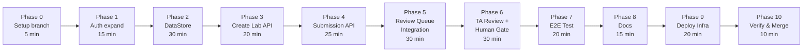

# 🎯 KẾ HOẠCH TRIỂN KHAI CHI TIẾT — THÀNH VIÊN 3 (Web Flow, TA Review Queue & Deployment)

> **Nhánh làm việc:** `feature/web-review-deployment`
> **Hạn chót:** 22:00, 25/11/2026
> **Trọng tâm Rubric:** Tiêu chí 1 (15đ) + Tiêu chí 5 (Review Queue + Human Gate) + Tiêu chí 7 (TDD) + Tiêu chí 8 (5đ)

---

## TỔNG QUAN CẤU TRÚC HIỆN TẠI

```
src/
├── app.ts                          ← Express app, hiện chỉ mount reviewQueueRouter
├── server.ts                       ← Khởi động server
├── errors/problem-details.ts       ← Helper trả lỗi RFC 9457 (400, 401, 403, 404)
├── middlewares/auth.middleware.ts   ← Mock auth (3 user: ta-class-1, ta-class-2, student-token)
├── routes/review-queue.ts          ← PA#02 endpoint GET /labs/:labId/review-queue (MOCK data)
├── queue/                          ← TV1 đã xong: SubmissionQueue + JudgeWorker
├── sandbox/runner.ts               ← TV1 đã xong: Docker sandbox runner
└── types/                          ← Interface contracts đã thống nhất cho cả 3 thành viên
tests/
├── sanity.test.ts                  ← 1 test healthz
├── contract/review-queue.contract.test.ts  ← 8 contract tests PA#02 (KHÔNG SỬA)
├── queue/idempotency.test.ts       ← TV1 tests
└── sandbox/runner.test.ts          ← TV1 tests (cần Docker)
```

> [!IMPORTANT]
> **Quy tắc bất di bất dịch:** 20 test hiện có phải luôn PASS. Mỗi commit mới phải qua `npm run check` (format → lint → typecheck → test). Contract tests PA#02 là bất khả xâm phạm.

---

## PHASE 0: CHUẨN BỊ MÔI TRƯỜNG (5 phút)

### Prompt cho Agent:

```
Tạo nhánh feature/web-review-deployment từ main.
Chạy `npm run check` để xác nhận baseline xanh.
KHÔNG ghi AI-LOG.md.
```

**Kết quả mong đợi:** Nhánh mới được tạo, 20/20 tests pass.

---

## PHASE 1: MỞ RỘNG AUTH MIDDLEWARE — Thêm 2 user mới (Admin + Student 2)

### Mục đích
Rubric Tiêu chí 1 yêu cầu 5 tài khoản test: 1 Admin, 2 TA (2 lớp khác nhau), 2 Sinh viên (thuộc lớp TA 1). Hiện tại `auth.middleware.ts` chỉ có 3 user (ta-class-1, ta-class-2, student-token). Cần thêm:
- 1 Admin (`admin-token`)
- 1 Sinh viên thứ 2 thuộc class-1 (`student-token-2`)

### Commit 1a — TEST FIRST

**File tạo:** `tests/routes/auth.test.ts`

```
test: thêm admin-token → user có role 'admin', assignedClassIds rỗng
test: thêm student-token-2 → user có role 'student', assignedClassIds ['class-1']
test: admin có thể truy cập review-queue của bất kỳ lab nào (admin bypass class check)
```

### Prompt cho Agent:

```
Đọc src/middlewares/auth.middleware.ts và src/types/review-queue.types.ts.

PHASE 1a — TEST FIRST:
Tạo file tests/routes/auth.test.ts với các test case sau bằng Vitest + Supertest:
1. "should authenticate admin-token and return user with role admin" 
   → GET /healthz với Bearer admin-token → 200 (chứng minh token hợp lệ)
2. "should authenticate student-token-2 for second student in class-1"
   → GET /healthz với Bearer student-token-2 → 200

Chạy test → phải FAIL (Red state) vì chưa có user trong MOCK_USERS.

PHASE 1b — IMPLEMENTATION:
Sửa src/middlewares/auth.middleware.ts, thêm 2 user vào MOCK_USERS:
- 'admin-token': { id: 'admin-001', username: 'admin_root', role: 'admin', assignedClassIds: [] }
- 'student-token-2': { id: 'std-200', username: 'student_user_2', role: 'student', assignedClassIds: ['class-1'] }

Chạy npm run check → 22/22 tests pass (20 cũ + 2 mới).
KHÔNG ghi AI-LOG.md.
```

### Git commits kỳ vọng:
```bash
git commit -m "test(auth): add test cases for admin and second student user tokens"
git commit -m "feat(auth): add admin and second student mock users to auth middleware"
```

---

## PHASE 2: IN-MEMORY DATA STORE — Thay thế hằng số Mock bằng Store động

### Mục đích
Hiện tại `review-queue.ts` dùng `const MOCK_REVIEW_QUEUE` cố định. Để hỗ trợ luồng hoàn chỉnh (tạo lab → nộp bài → engine đẩy verdict → TA duyệt → publish), cần 1 lớp Data Store trung tâm quản lý:
- **Labs** (tạo mới, tra cứu, kiểm tra class ownership)
- **Submissions** (lưu bài nộp, trạng thái, kết quả sandbox)
- **Review Queue Items** (nhận verdict từ constraint engine, cập nhật trạng thái duyệt)

### Commit 2a — TEST FIRST

**File tạo:** `tests/store/data-store.test.ts`

### Prompt cho Agent:

```
PHASE 2a — THIẾT KẾ VÀ TEST FIRST cho Data Store:

Đọc kỹ các type đã có: src/types/review-queue.types.ts (Lab, ReviewQueueItem, PublishStatus, AuthUser), 
src/types/sandbox.types.ts (SubmissionJob, SandboxExecutionResult, TestCase),
src/types/constraint.types.ts (ConstraintVerdict, ConstraintDefinition).

Tạo file tests/store/data-store.test.ts với các test case sau:

describe('DataStore — Labs'):
1. "createLab() should store a lab and return it by id"
2. "createLab() should reject duplicate lab id"  
3. "getLab() should return null for non-existent lab"
4. "getLabsByClassId() should return only labs belonging to that class"

describe('DataStore — Submissions'):
5. "createSubmission() should store submission and return submissionId"
6. "getSubmission() should return submission with status"
7. "updateSubmissionResult() should store sandbox execution result"

describe('DataStore — Review Queue'):
8. "addReviewItem() should add a review queue item and retrieve it by labId"
9. "getReviewQueue() should filter by status and verdict with pagination"
10. "reviewItem() should change status from pending to reviewed with TA info and timestamp"
11. "getPublishStatus() should return canPublish=false when pending items exist"
12. "getPublishStatus() should return canPublish=true when all items are reviewed"

Chạy tests → phải FAIL (Red state).
Rồi tạo src/store/data-store.ts để implement class DataStore đủ để pass tất cả test trên.
Export 1 singleton defaultDataStore.

Mọi dữ liệu lưu trong Map/Array in-memory (không cần database thật).

LƯU Ý QUAN TRỌNG:
- DataStore phải tương thích 100% với các TypeScript interface đã có trong src/types/.
- ReviewQueueItem trong store phải thêm field labId (để query theo lab).
- Giữ nguyên MOCK_REVIEW_QUEUE trong review-queue.ts chưa sửa (sẽ sửa ở Phase sau).
- Chạy npm run check → toàn bộ test cũ + mới phải pass.
KHÔNG ghi AI-LOG.md.
```

### Git commits kỳ vọng:
```bash
git commit -m "test(store): add unit tests for in-memory data store (labs, submissions, review queue)"
git commit -m "feat(store): implement in-memory DataStore for labs, submissions and review queue"
```

---

## PHASE 3: API TẠO LAB — `POST /api/v1/classes/:classId/labs`

### Mục đích
TA tạo bài lab mới với statement, test cases, và constraints kèm deduction.

### Prompt cho Agent:

```
PHASE 3 — Tạo Lab API (TDD):

Đọc: src/types/review-queue.types.ts (Lab interface), src/store/data-store.ts,
src/routes/review-queue.ts (tham khảo pattern routing + auth + error handling hiện có),
src/errors/problem-details.ts.

PHASE 3a — TEST FIRST:
Tạo file tests/routes/labs.test.ts:

describe('POST /api/v1/classes/:classId/labs'):
1. "should create a lab and return 201 with lab object when called by assigned TA"
   → POST body: { title, statement, testCases: [{id,input,expectedOutput}], constraints: [{id,description,deduction,type}] }
   → Bearer ta-class-1, classId = 'class-1'
   → Expect 201, body có id, classId, title, testCases, constraints
2. "should reject with 403 when TA is not assigned to the class"
   → Bearer ta-class-1, classId = 'class-2' → 403
3. "should reject with 403 when student tries to create a lab"
   → Bearer student-token → 403
4. "should reject with 401 when no auth token"
   → Không có Authorization header → 401
5. "should reject with 400 when required fields are missing"
   → POST body thiếu title → 400

Chạy test → FAIL.

PHASE 3b — IMPLEMENTATION:
Tạo file src/routes/labs.ts:
- Router với POST /api/v1/classes/:classId/labs
- Dùng authMiddleware
- Kiểm tra role phải là 'ta' hoặc 'admin'
- Kiểm tra TA thuộc classId đó (admin bypass)
- Validate body (title bắt buộc, testCases array, constraints array)
- Gọi dataStore.createLab(...)
- Trả 201 + lab object

Đăng ký labsRouter vào src/app.ts.

Chạy npm run check → toàn bộ test pass.
KHÔNG ghi AI-LOG.md.
```

### Git commits kỳ vọng:
```bash
git commit -m "test(labs): add contract tests for lab creation and constraint binding"
git commit -m "feat(labs): implement lab creation endpoint with class ownership validation"
```

---

## PHASE 4: API NỘP BÀI — `POST /api/v1/classes/:classId/labs/:labId/submissions`

### Mục đích
Sinh viên nộp mã nguồn C++, hệ thống đẩy job vào SubmissionQueue của TV1, trả về submissionId.

### Prompt cho Agent:

```
PHASE 4 — Submission API (TDD):

Đọc: src/queue/submission-queue.ts, src/queue/index.ts (SubmissionQueue API),
src/types/sandbox.types.ts (SubmissionJob), src/store/data-store.ts.

PHASE 4a — TEST FIRST:
Tạo file tests/routes/submissions.test.ts:

describe('POST /api/v1/classes/:classId/labs/:labId/submissions'):
1. "should accept C++ source code from student and return 202 with submissionId"
   → Trước tiên tạo 1 lab bằng POST (hoặc seed trực tiếp vào dataStore)
   → POST body: { sourceCode: '#include<iostream>\nint main(){}' }
   → Bearer student-token, classId = 'class-1'
   → Expect 202, body có submissionId, status: 'queued'
2. "should reject with 403 when student is not in the class"
   → student không thuộc classId → 403
3. "should reject with 404 when lab does not exist"
   → labId không tồn tại → 404
4. "should reject with 400 when sourceCode is empty or missing"
   → body rỗng → 400

describe('GET /api/v1/submissions/:submissionId'):
5. "should return submission status for the submitting student"
   → GET với submissionId vừa tạo → 200, có status, có compileSuccess (nếu đã chấm)
6. "should NOT expose constraint verdicts to student before publish"
   → Response không chứa trường verdict/evidence/suggestedDeduction
7. "should reject with 404 for non-existent submissionId"

Chạy test → FAIL.

PHASE 4b — IMPLEMENTATION:
Tạo file src/routes/submissions.ts:
- POST /api/v1/classes/:classId/labs/:labId/submissions
  + authMiddleware
  + Kiểm tra student thuộc classId
  + Kiểm tra lab tồn tại và thuộc classId
  + Tạo submissionId (uuid), lưu vào dataStore
  + Tạo SubmissionJob, gọi submissionQueue.enqueue(job)
  + Trả 202 { submissionId, status: 'queued' }
- GET /api/v1/submissions/:submissionId
  + authMiddleware
  + Trả trạng thái biên dịch + pass/fail tests
  + KHÔNG trả verdict/evidence (bảo mật trước khi publish)

Import uuid từ crypto.randomUUID() (Node built-in).
Đăng ký submissionsRouter vào src/app.ts.

Chạy npm run check → toàn bộ test pass.
KHÔNG ghi AI-LOG.md.
```

### Git commits kỳ vọng:
```bash
git commit -m "test(submissions): add tests for submission intake and status tracking"
git commit -m "feat(submissions): implement submission intake and status query endpoints"
```

---

## PHASE 5: TÍCH HỢP ENGINE VERDICTS VÀO REVIEW QUEUE — Nối pipeline

### Mục đích
Kết nối kết quả sandbox (TV1) và constraint verdict (TV2) vào Review Queue. Vì TV2 chưa xong, dùng Mock Engine Stub.

### Prompt cho Agent:

```
PHASE 5 — Tích hợp Pipeline + Nâng cấp Review Queue Endpoint (TDD):

Đọc kỹ: src/routes/review-queue.ts (endpoint hiện tại dùng MOCK cố định),
src/store/data-store.ts, docs/contract/review-queue.md (hợp đồng PA#02),
tests/contract/review-queue.contract.test.ts (8 test contract — KHÔNG ĐƯỢC SỬA).

MỤC TIÊU: Chuyển GET /labs/:labId/review-queue từ dùng MOCK_REVIEW_QUEUE cố định 
sang đọc dữ liệu động từ DataStore, MÀ KHÔNG LÀM FAIL bất kỳ contract test nào.

PHASE 5a — TEST FIRST:
Thêm test vào tests/routes/review-queue-integration.test.ts:

describe('Review Queue Integration — Dynamic Data'):
1. "should return verdicts pushed by constraint engine for a specific lab"
   → Seed dataStore: tạo lab, thêm review items, query → items trả về đúng
2. "should return empty queue for a lab with no submissions"
3. "should correctly paginate dynamic review queue data"

Chạy test → FAIL.

PHASE 5b — IMPLEMENTATION:

Sửa src/routes/review-queue.ts:
- Import defaultDataStore
- Thay thế MOCK_REVIEW_QUEUE bằng dataStore.getReviewQueue(labId, filters)
- Giữ nguyên VALID_LAB_ID và VALID_LAB_CLASS_ID exports (contract tests phụ thuộc)
- MẸO QUAN TRỌNG: Seed MOCK_REVIEW_QUEUE vào dataStore khi module load, 
  để contract tests PA#02 vẫn thấy đúng dữ liệu mock cũ.
  Cụ thể: gọi dataStore.createLab() với VALID_LAB_ID thuộc VALID_LAB_CLASS_ID,
  rồi gọi dataStore.addReviewItem() cho từng item trong MOCK_REVIEW_QUEUE.
- Logic routing + auth + validation giữ nguyên 100%.

PHASE 5c — Tạo Mock Constraint Engine Adapter:
Tạo src/engine/constraint-adapter.ts:
- Export function evaluateSubmission(sourceCode, constraints): ConstraintVerdict[]
- Hiện tại trả mock data cố định (sẽ được TV2 thay thế sau bằng hard-rules + LLM thật)
- Trong mock: trả 1 verdict violation cho constraint đầu tiên, 1 pass cho các constraint còn lại

Chạy npm run check → TOÀN BỘ test (cũ + mới) phải pass, ĐẶC BIỆT 8 contract tests.
KHÔNG ghi AI-LOG.md.
```

> [!CAUTION]
> Đây là phase nguy hiểm nhất. Nếu sửa review-queue.ts mà làm fail contract test PA#02 → phải rollback ngay. Yêu cầu Agent kiểm tra kỹ trước khi commit.

### Git commits kỳ vọng:
```bash
git commit -m "test(review-queue): add integration tests for dynamic review queue data"
git commit -m "feat(review-queue): integrate DataStore into review queue endpoint preserving PA02 contract"
git commit -m "feat(engine): add mock constraint engine adapter for pipeline integration"
```

---

## PHASE 6: TA REVIEW ACTIONS — Duyệt item + Human Gate

### Mục đích
- TA review từng item trong queue (approve/override verdict)
- Chốt chặn: Chặn publish điểm nếu còn item pending

### Prompt cho Agent:

```
PHASE 6 — TA Review Actions + Human Gate (TDD):

Đọc: docs/contract/review-queue.md (Section 6 — Publish Gate),
src/types/review-queue.types.ts (PublishStatus interface).

PHASE 6a — TEST FIRST:
Tạo file tests/routes/review-actions.test.ts:

describe('POST /api/v1/classes/:classId/labs/:labId/review-queue/:itemId/decision'):
1. "should allow TA to approve a pending item → status becomes reviewed"
   → POST body: { decision: 'confirm' } với Bearer ta-class-1
   → 200, item.status = 'reviewed', reviewedBy = ta id, reviewedAt = ISO string
2. "should allow TA to override verdict"
   → POST body: { decision: 'override', newVerdict: 'pass', reason: 'False positive' }
   → 200, verdict updated
3. "should reject with 403 when TA from different class tries to review"
4. "should reject with 404 when itemId does not exist"
5. "should reject with 409 when item is already reviewed"

describe('GET /api/v1/classes/:classId/labs/:labId/publish-status'):
6. "should return canPublish=false and unreviewedCount when pending items exist"
7. "should return canPublish=true and unreviewedCount=0 after all items reviewed"

describe('POST /api/v1/classes/:classId/labs/:labId/publish'):
8. "should reject with 400 when unreviewed items remain"
   → 400, body chứa unreviewedCount > 0
9. "should succeed with 200 when all items are reviewed"
   → Duyệt hết items trước → POST publish → 200
10. "should reject with 403 when student tries to publish"
11. "should reject with 403 when TA from other class tries to publish"

Chạy test → FAIL.

PHASE 6b — IMPLEMENTATION:
Thêm routes vào src/routes/review-queue.ts (hoặc tạo file mới src/routes/review-actions.ts):

- POST /:classId/labs/:labId/review-queue/:itemId/decision
  + authMiddleware, role check (ta/admin), class ownership check
  + Validate decision enum: 'confirm' | 'override'
  + Nếu override: validate newVerdict
  + Gọi dataStore.reviewItem(itemId, userId, decision)
  + Trả 200

- GET /api/v1/classes/:classId/labs/:labId/publish-status
  + authMiddleware, role check
  + Gọi dataStore.getPublishStatus(labId)
  + Trả 200 { canPublish, unreviewedCount }

- POST /api/v1/classes/:classId/labs/:labId/publish
  + authMiddleware, role check (ta/admin), class ownership
  + Kiểm tra publishStatus → nếu unreviewedCount > 0 → trả 400 với lý do
  + Nếu canPublish → đánh dấu lab đã publish, trả 200

Đăng ký routes vào app.ts.

Chạy npm run check → toàn bộ test pass.
KHÔNG ghi AI-LOG.md.
```

### Git commits kỳ vọng:
```bash
git commit -m "test(review): add tests for TA review decisions and publish gate enforcement"
git commit -m "feat(review-queue): integrate constraint engine verdicts into review queue"
git commit -m "feat(publish): enforce human gate blocking publish on unreviewed items"
```

---

## PHASE 7: FULL PIPELINE INTEGRATION TEST — Kịch bản End-to-End

### Mục đích
Viết 1 test kịch bản xuyên suốt (Tiêu chí 1): TA tạo lab → Sinh viên nộp 3 bài (compliant, violation, injection) → Bài vào queue → TA duyệt → Publish điểm.

### Prompt cho Agent:

```
PHASE 7 — End-to-End Integration Test:

Tạo file tests/integration/full-pipeline.test.ts:

describe('Full Pipeline — Criterion 1 Scenario'):
Viết 1 test kịch bản tuần tự:

1. TA (ta-class-1) tạo lab "sort-merge" thuộc class-1 với:
   - 2 test cases: input "5 3 1" → output "1 3 5"; input "1" → output "1"
   - 2 constraints: 
     + { id: 'NO_STD_SORT', description: 'Do not call std::sort', deduction: 3, type: 'ban-list' }
     + { id: 'USE_RECURSION', description: 'Must use recursive merge sort', deduction: 2, type: 'semantic' }
   → Expect 201

2. Student (student-token) nộp bài compliant (clean merge sort code)
   → POST submission → 202, nhận submissionId-1

3. Student nộp bài violation (code chứa std::sort)
   → POST submission → 202, nhận submissionId-2

4. Student nộp bài injection (code chứa prompt injection trong comment)
   → POST submission → 202, nhận submissionId-3

5. Mock engine đẩy verdicts vào review queue:
   - submissionId-1: pass cho cả 2 constraints
   - submissionId-2: violation cho NO_STD_SORT, pass cho USE_RECURSION
   - submissionId-3: unsure cho cả 2 (prompt injection detected)

6. TA kiểm tra publish-status → canPublish: false, unreviewedCount > 0

7. TA cố publish → bị chặn 400

8. TA duyệt từng item trong review queue

9. TA kiểm tra publish-status → canPublish: true

10. TA publish thành công → 200

Chạy npm run check → toàn bộ test pass.
KHÔNG ghi AI-LOG.md.
```

### Git commit kỳ vọng:
```bash
git commit -m "test(integration): add end-to-end pipeline test for criterion 1 lab scenario"
```

---

## PHASE 8: CHUẨN BỊ HỒ SƠ NỘP BÀI

### Mục đích
Tạo các file tài liệu bắt buộc cho PA#3.

### Prompt cho Agent:

```
PHASE 8 — Tạo hồ sơ nộp bài PA#3:

8a. Tạo file PA3.md tại thư mục gốc PROJECT/LeeTKOB---WebNC/ với nội dung:
- Tiêu đề: PA#3 — Prototype with the LLM feature running
- Thông tin nhóm (3 thành viên: 23120319, 23120327, 23120380)
- Link deployment: [ĐỂ TRỐNG — sẽ điền sau khi deploy]
- 5 tài khoản test:
  | Vai trò | Token | Username |
  | Admin | admin-token | admin_root |
  | TA Lớp 1 | ta-class-1 | ta_instructor_1 |
  | TA Lớp 2 | ta-class-2 | ta_instructor_2 |
  | Sinh viên 1 | student-token | student_user_1 |
  | Sinh viên 2 | student-token-2 | student_user_2 |
- Link CI run: [ĐỂ TRỐNG — sẽ điền sau khi CI xanh]
- Hướng dẫn chạy Docker Checker CLI: [ĐỂ TRỐNG — TV2 cung cấp]
- Link video demo: [ĐỂ TRỐNG — sẽ quay sau]

8b. Tạo file SELF_ASSESSMENT_REPORT.md tại thư mục gốc:
- Tự chấm 100/100 theo 8 tiêu chí
- Mỗi tiêu chí dẫn link commit/file minh chứng
- Dùng bảng markdown rõ ràng
- Các ô link commit để [PLACEHOLDER] — sẽ điền commit hash thật sau

KHÔNG ghi AI-LOG.md.
```

### Git commits kỳ vọng:
```bash
git commit -m "docs(pa3): add PA3.md submission report with deployment info and test accounts"
git commit -m "docs(pa3): add self-assessment report template with criterion evidence links"
```

---

## PHASE 9: TRIỂN KHAI ĐÁM MÂY (Cloud Deployment)

> [!WARNING]
> Phase này cần network access và tài khoản cloud thật. Agent không thể tự deploy mà cần bạn cung cấp credentials hoặc thực hiện bước deploy thủ công.

### Prompt cho Agent:

```
PHASE 9 — Chuẩn bị Deployment Infrastructure:

9a. Tạo docker-compose.yml tại thư mục gốc:
- service: leetkob-api (Node.js app)
- service: leetkob-sandbox (sandbox runner image)
- Healthcheck cho leetkob-api
- Environment variables từ .env
- Ports: 3000:3000

9b. Tạo Dockerfile (production) tại thư mục gốc:
- Base: node:20-alpine
- Multi-stage build: install → build → run
- Copy dist/ và node_modules/
- USER node (non-root)
- CMD ["node", "dist/server.js"]

9c. Tạo scripts/seed-accounts.ts:
- Script seed 5 tài khoản test vào hệ thống khi khởi động
- Gọi khi server startup nếu NODE_ENV !== 'production' hoặc khi chạy lần đầu

KHÔNG ghi AI-LOG.md.
```

### Các bước thủ công sau khi Agent hoàn thành:
1. Chọn platform: **Railway** (đơn giản nhất cho Node.js + Docker)
2. `railway login` → `railway init` → `railway up`
3. Hoặc dùng **Render**: connect GitHub repo, chọn Docker deploy
4. Set environment variables trên platform
5. Cập nhật link deployment vào `PA3.md`

### Git commits kỳ vọng:
```bash
git commit -m "feat(deploy): add production Dockerfile, docker-compose and seed script"
```

---

## PHASE 10: RÀ SOÁT CUỐI CÙNG & MERGE

### Prompt cho Agent:

```
PHASE 10 — Final verification:

1. Chạy npm run check và báo cáo kết quả chi tiết (số test, thời gian).
2. Liệt kê tất cả file đã tạo/sửa trong nhánh feature/web-review-deployment.
3. Kiểm tra không có file nào import trực tiếp từ src/checker/ 
   (phần của TV2 — chưa tồn tại).
4. Kiểm tra eslint + prettier clean.
5. Xuất danh sách commits trên nhánh này.

KHÔNG ghi AI-LOG.md.
```

### Các bước thủ công:
```bash
# Tạo PR trên GitHub
git push origin feature/web-review-deployment
# Tạo Pull Request → KHÔNG squash merge → dùng "Create a merge commit" hoặc "Rebase and merge"
```

---

## TỔNG KẾT TIMELINE & COMMITS



| Phase | Commits | Tests mới (ước tính) | Thời gian |
|:---:|:---:|:---:|:---:|
| 0 | 0 | 0 | 5 phút |
| 1 | 2 | +2 | 15 phút |
| 2 | 2 | +12 | 30 phút |
| 3 | 2 | +5 | 20 phút |
| 4 | 2 | +7 | 25 phút |
| 5 | 3 | +3 | 30 phút |
| 6 | 3 | +11 | 30 phút |
| 7 | 1 | +1 (E2E) | 20 phút |
| 8 | 2 | 0 | 15 phút |
| 9 | 1 | 0 | 20 phút |
| 10 | 0 | 0 | 10 phút |
| **Tổng** | **~18** | **~41** | **~3.5 giờ** |

---

## DANH SÁCH FILE SẼ TẠO MỚI

```
src/store/data-store.ts              ← In-memory data store
src/routes/labs.ts                   ← Lab creation endpoint
src/routes/submissions.ts            ← Submission intake + status query
src/routes/review-actions.ts         ← TA review decisions + publish gate
src/engine/constraint-adapter.ts     ← Mock constraint engine (TV2 thay thế sau)
scripts/seed-accounts.ts             ← Seed 5 test accounts

tests/routes/auth.test.ts            ← Auth expansion tests
tests/store/data-store.test.ts       ← DataStore unit tests
tests/routes/labs.test.ts            ← Lab creation tests
tests/routes/submissions.test.ts     ← Submission tests
tests/routes/review-queue-integration.test.ts  ← Dynamic review queue tests
tests/routes/review-actions.test.ts  ← TA review + publish gate tests
tests/integration/full-pipeline.test.ts  ← E2E scenario test

PA3.md                               ← Submission report
SELF_ASSESSMENT_REPORT.md            ← Self-assessment
Dockerfile                           ← Production Docker image
docker-compose.yml                   ← Multi-service compose
```

## DANH SÁCH FILE SẼ SỬA

```
src/middlewares/auth.middleware.ts    ← Thêm admin-token + student-token-2
src/routes/review-queue.ts           ← Chuyển từ MOCK sang DataStore (seed mock data giữ contract)
src/app.ts                           ← Mount thêm labsRouter, submissionsRouter, reviewActionsRouter
```

> [!TIP]
> Bạn có thể copy từng prompt Phase và paste trực tiếp vào Agent. Mỗi Phase độc lập và tuần tự, kết thúc bằng `npm run check` xanh. Nếu Phase nào fail, rollback commit đó và chạy lại prompt với context lỗi.
